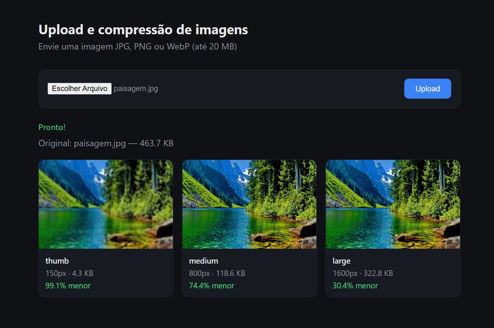
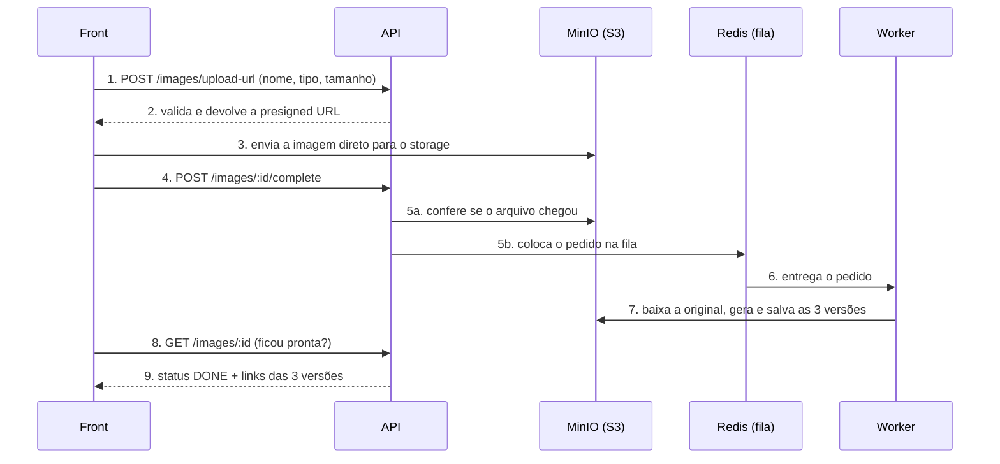

# Serviço de upload e compressão de imagens

Serviço backend que recebe imagens e gera versões otimizadas delas em três tamanhos, no formato WebP. O upload vai direto para o storage e o processamento acontece em segundo plano, então a API não carrega arquivos nem fica lenta com o processamento.



---

## O problema

Fotos tiradas no celular costumam ter de **3 a 8 MB**. Em sistemas onde as pessoas sobem imagens e outras pessoas veem essas imagens (e-commerce, marketplaces, imobiliárias, delivery), usar a foto original causa:

- **Páginas lentas**: uma vitrine com 20 produtos pode passar de 100 MB.
- **Gasto de internet** para quem acessa pelo celular.
- **Custo de banda** maior para a empresa.
- **Pior posição no Google**, que penaliza sites lentos.

Quem sobe a imagem manda o arquivo grande; quem vê precisa de um arquivo pequeno.

## A solução

O serviço recebe a imagem original e gera três versões:

| Versão | Largura | Uso |
|---|---|---|
| `thumb` | 150px | miniaturas, listagens, grades |
| `medium` | 800px | telas de celular |
| `large` | 1600px | telas de computador, imagem ampliada |

Todas em **WebP**, com qualidade entre 75 e 80. Em um teste com uma imagem de 141,7 KB, a versão `thumb` ficou com **1,5 KB (99% menor)**.

---

## Fluxo



Status da imagem no banco:

```
AWAITING_UPLOAD → PENDING → PROCESSING → DONE
        ↓                              ↘ FAILED
     EXPIRED
```

`EXPIRED` é o upload que pediu o link mas nunca foi concluído (ver [limpeza de uploads abandonados](#8-limpeza-de-uploads-abandonados)).

---

## Decisões técnicas

### 1. Upload direto para o storage com presigned URL

A imagem **não passa pela API**. A API só valida o pedido e gera uma **presigned URL**: um link temporário, assinado com as credenciais do storage, que autoriza o envio de **um arquivo específico**.

**Por quê:** se o arquivo passasse pela API, ela teria que segurar a conexão aberta durante todo o upload e depois reenviar o arquivo para o storage, gastando banda duas vezes e ocupando memória. Com vários uploads ao mesmo tempo, a API ficaria lenta para todos.

**Como o envio é controlado:** o front nunca recebe as credenciais do storage, só a autorização. As regras ficam **assinadas dentro do link**, e quem confere é o próprio storage:

```ts
createPresignedPost(s3, {
  Key: key,                                  // só pode salvar nesse caminho
  Conditions: [
    ['content-length-range', 1, maxBytes],   // até 20 MB
    ['eq', '$Content-Type', contentType],    // só o tipo informado
  ],
  Expires: 300,                              // vale 5 minutos
})
```

**Presigned POST em vez de PUT:** a versão PUT não permite limitar o tamanho do arquivo. Com POST, o limite vai na política assinada e o storage recusa qualquer arquivo maior, **mesmo que o front tenha informado um tamanho falso**. A validação feita na API serve só para avisar o usuário mais rápido; a garantia real está no storage.

### 2. Processamento em segundo plano com fila (Redis + BullMQ)

Gerar as versões com o Sharp consome bastante CPU. Se isso rodasse dentro da API, vários uploads simultâneos deixariam todas as requisições lentas.

Por isso, a API só registra um pedido na fila e responde na hora (`202 Accepted`). Um **worker separado** consome a fila e faz o processamento.

- **Resiliência:** se o worker cair, os pedidos continuam guardados no Redis e são processados quando ele voltar. Um pedido interrompido no meio volta para a fila automaticamente.
- **Retry:** até 3 tentativas, com espera exponencial (2s, 4s, 8s) entre elas.
- **Escala:** dá para subir mais workers sem mexer na API.

### 3. Storage para arquivos, banco para metadados

As imagens ficam no **MinIO** (compatível com S3) e o **Postgres** guarda só os metadados: nome, tipo, tamanho, status e caminho dos arquivos. Guardar arquivos no banco deixaria as consultas e os backups pesados.

Só a pasta `processed/` tem leitura pública. As imagens originais continuam privadas.

### 4. Não confiar no tipo informado pelo cliente

A API e o storage só veem o tipo **declarado**, que pode ser falso (um `.exe` renomeado para `.jpg`, por exemplo). Por isso o worker lê o **conteúdo real** do arquivo com o Sharp antes de processar.

Se não for JPEG, PNG ou WebP, o worker apaga o arquivo e lança um `UnrecoverableError`, que avisa o BullMQ para **não tentar de novo**, já que repetir não mudaria o resultado. A imagem é marcada como `FAILED` com o motivo.

### 5. Idempotência e ordem das operações

- O pedido entra na fila com `jobId` igual ao id da imagem. Se o front avisar "terminei" duas vezes, o pedido não é duplicado.
- O pedido é colocado na fila **antes** de atualizar o status no banco. Se o Redis estiver fora do ar, a operação falha sem deixar a imagem presa em `PENDING`, e o front pode tentar de novo.
- O worker sempre grava as versões no mesmo caminho (`processed/{id}/thumb.webp`). Reprocessar sobrescreve, sem duplicar.

### 6. Detalhes do processamento

- `.rotate()` corrige automaticamente fotos de celular que ficariam "deitadas".
- `withoutEnlargement` impede que uma imagem pequena seja esticada, o que só a deixaria borrada e mais pesada.

### 7. Arquitetura em camadas

```
routes → controllers → services → repositories
```

- **Controller:** só lida com HTTP (recebe a requisição e responde).
- **Service:** regras de negócio (validação, geração do link, fila).
- **Repository:** único ponto de acesso ao banco, reaproveitado pela API e pelo worker.

As variáveis de ambiente são validadas com Zod na inicialização: se faltar alguma, a aplicação nem sobe.

### 8. Limpeza de uploads abandonados

Se alguém pede o link e fecha a página antes de enviar a imagem, o registro fica em `AWAITING_UPLOAD` para sempre, e um arquivo enviado e nunca confirmado fica parado no storage.

O worker agenda, pelo próprio BullMQ, uma tarefa recorrente (a cada `CLEANUP_INTERVAL_MINUTES`, padrão 10 min). Ela marca como `EXPIRED` os uploads com mais de `ABANDONED_UPLOAD_MINUTES` (padrão 60 min) e apaga o arquivo que sobrou.

- **Sem corrida:** a expiração só acontece se o status ainda for `AWAITING_UPLOAD`, em uma única operação no banco. Se o front concluir o upload no meio da limpeza, nada é apagado. Concluir um upload já expirado responde `410`.
- **Sem duplicar:** o agendamento tem um id fixo, então reiniciar o worker ou subir vários não cria tarefas repetidas.
- **Em lotes** de 100, do mais antigo para o mais novo, usando o índice `(status, createdAt)`.

### 9. CORS restrito no storage

O navegador envia a imagem direto para o storage, então o storage precisa liberar o domínio do front. A lista vem de `CORS_ALLOWED_ORIGINS` (padrão `http://localhost:3333`, aceita vários separados por vírgula). A API grava a regra no bucket ao subir, o que vale também para um S3 real, e o `docker-compose.yml` repassa a mesma lista ao RustFS. Origens fora da lista recebem `403`.

### 10. Rate limit

Limite por IP a cada minuto, só nas rotas de imagem: 10 em `/images/upload-url`, 30 em `/images/:id/complete` e 120 em `/images/:id` (o front consulta a cada segundo). Estourou, responde `429` com o cabeçalho `Retry-After`. `/health` e a página não têm limite.

O contador fica na memória da API. Com mais de uma instância, o ideal é guardá-lo no Redis. Atrás de um proxy ou balanceador, configure `trustProxy` no Fastify para o limite enxergar o IP real.

### 11. Health check de verdade

`GET /health` testa o Postgres, o Redis e o storage, cada um com limite de 2 s. Responde `200` se os três estão no ar, ou `503` dizendo qual caiu:

```json
{ "status": "degraded", "checks": { "database": "ok", "redis": "down", "storage": "ok" } }
```

### 12. Desligamento limpo

Ao receber `SIGINT` ou `SIGTERM`, a API para de aceitar pedidos novos e termina os que estão em andamento. O worker termina o job atual, o que evita imagem presa em `PROCESSING`. Depois os dois fecham fila, Redis, banco e storage. Se passar de 10 s, o processo é encerrado à força.

---

## Stack

- **Node.js + TypeScript**
- **Fastify**: API
- **Sharp**: redimensionamento e conversão para WebP
- **MinIO / RustFS**: storage compatível com S3 (AWS SDK v3). O `docker-compose.yml` usa o RustFS porque a imagem `minio/minio` saiu do Docker Hub; o serviço continua chamado `minio` e qualquer storage S3 serve
- **PostgreSQL + Prisma 7**: metadados e status
- **Redis + BullMQ**: fila de processamento e tarefas agendadas
- **Zod**: validação
- **@fastify/rate-limit**: limite de requisições
- **Docker Compose**: infraestrutura local

---

## Como rodar

**Pré-requisitos:** Node.js 20+, Yarn e Docker.

```bash
# 1. variáveis de ambiente
cp .env.example .env

# 2. infraestrutura (Postgres, Redis e storage)
docker compose up -d

# 3. dependências e banco
yarn
yarn prisma migrate dev
yarn prisma generate

# 4. API e worker (em dois terminais)
yarn dev
yarn dev:worker
```

Abra **http://localhost:3333**, escolha uma imagem e clique em **Upload**.

Painel do storage: **http://localhost:9001** (usuário e senha definidos no `.env`).

O Postgres do Docker fica na porta **5433** para não conflitar com um Postgres instalado na máquina (porta 5432).

### Variáveis de ambiente opcionais

| Variável | Padrão | Para quê |
|---|---|---|
| `MAX_UPLOAD_MB` | `20` | tamanho máximo do arquivo |
| `CORS_ALLOWED_ORIGINS` | `http://localhost:3333` | domínios do front que podem enviar para o storage |
| `ABANDONED_UPLOAD_MINUTES` | `60` | depois disso, um upload não concluído expira (mínimo 10) |
| `CLEANUP_INTERVAL_MINUTES` | `10` | de quanto em quanto tempo o worker procura uploads abandonados |

---

## Endpoints

| Método | Rota | Descrição |
|---|---|---|
| `POST` | `/images/upload-url` | Valida o pedido e devolve a presigned URL |
| `POST` | `/images/:id/complete` | Confirma o upload e coloca a imagem na fila |
| `GET` | `/images/:id` | Status da imagem e links das versões |
| `GET` | `/health` | Verifica API, banco, Redis e storage (`200` ou `503`) |

Códigos que o front deve tratar: `429` (rate limit, veja `Retry-After`) e `410` (upload expirado, peça um novo link).

---

## Próximos passos

O projeto foi feito como estudo de arquitetura. Para produção, ainda seriam necessários:

- **Autenticação** nas rotas de upload
- **Lifecycle rule** no bucket para as originais
- **Usuário próprio no storage**, com permissões mínimas, em vez do usuário root
- **Rate limit no Redis**, para valer entre várias instâncias da API
- **Testes** e **monitoramento**
- **Notificação em tempo real** (WebSocket ou SSE) no lugar da consulta a cada segundo
- Suporte a **outros tipos de arquivo**, como compressão de PDF, adicionando novos jobs no worker